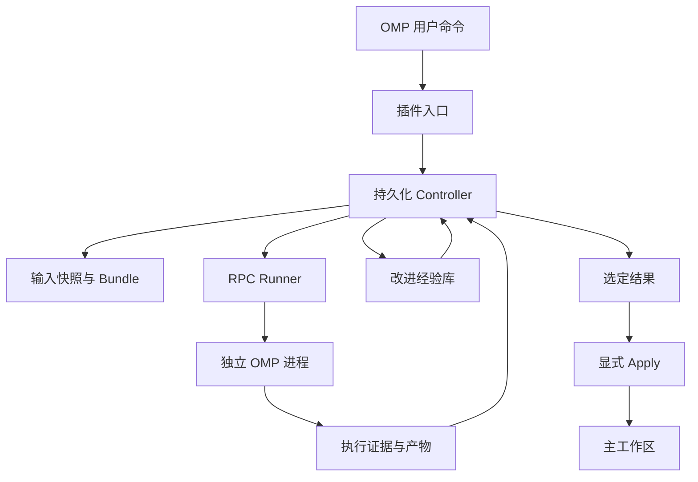
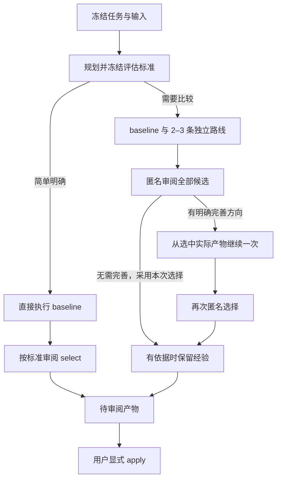
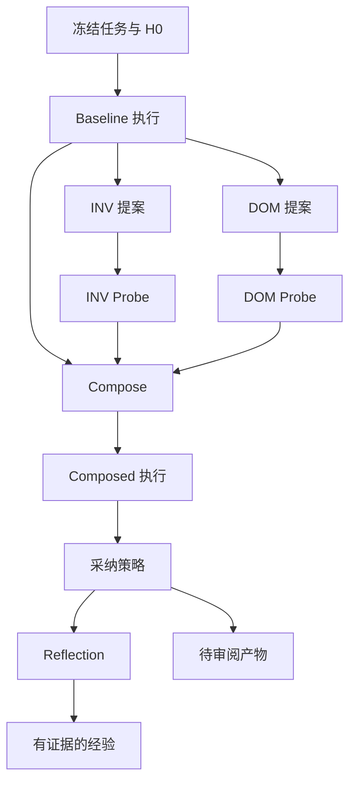

# OMP Harness² 架构

本文件描述 alpha 的目标架构、约束和验证要求。模块与状态是逻辑划分，实际文件名和类型以实现为准；文中的“必须”是待测试的契约，不是对当前完成度的声明。

## 架构决策

采用 **OMP 插件入口 + 持久化 controller + 独立 OMP RPC 进程**。插件不接管 OMP 内部 agent loop。controller 通过公开的进程边界执行任务，并独立保存状态、证据、候选和经验。

本机选用的执行器版本为 OMP `18.13.1`，Bun 为 `1.4.0`；研究时查看的较新 OMP SDK 文档要求 Bun `1.4.4` 或更新版本。因此 alpha 优先调用已安装 OMP 的 RPC，而不在插件宿主中嵌入较新 SDK。启动时仍需核实实际二进制与协议能力；版本字符串不能代替兼容性验证。

OMP RPC 使用换行分隔的 JSON 协议，不是 JSON-RPC 2.0。runner 必须按支持的 OMP 版本实现握手、命令关联、事件收集、取消与完成判断，不能把首个 `agent_end` 一律视为任务终态。

## 当前执行 Profile

当前 runner 明确关闭原生 OMP 工具、extensions、skills、rules、context files、LSP 和自动发现，再通过 RPC 注册固定的 host-owned 文件工具。solver 可以读取、列出及写入私有任务副本；editor、selector 和 reflector 只读。所有角色都没有 shell、测试命令、网络工具、MCP 或子代理能力。

`H0` 是这一受限 profile 加空的学习策略，不是完整原生 OMP 或用户当前会话配置的快照。实验只能直接归因于相同 profile 内的 harness 差异。skills 以虚拟 `harness://skills/` 资源按需读取，不安装到 OMP 的环境发现目录，不加载生成的 TS 代码。

每个 worker 使用私有配置/会话根与明确的 direct API 模型，不继承 OAuth、订阅登录数据库、自定义 gateway 或 provider fallback。认证只使用允许的 API key 环境变量。实际 home 中存在 `.env` 会阻止 worker 启动，因为 OMP 会自动加载它；该限制在调用模型前检查。

## 稳定控制层与可编辑面

| 稳定控制层，不允许模型修改 | 候选 harness，可在明确范围内修改 |
| --- | --- |
| controller 与 runner 代码 | 附加 prompt 与执行指导 |
| 初始任务及输入快照 | tool guidance |
| 权限、预算和取消机制 | 实现支持的声明式 skills/资源 |
| 协议、产物路径与 schema 校验 | 后续版本明确开放的其他组件 |
| 采纳、apply 与经验发布逻辑 | 不包含 controller 自身 |
| 隐藏评估及外部服务凭证边界 | 不包含权限扩张或评估答案 |

模型生成的文本、文件名和产物引用都作为数据处理。controller 不直接执行候选提供的任意命令，也不把候选 extension 安装进用户主 OMP 进程。未来开放脚本和代码插件时，应另行定义隔离与发布门槛。

## Product 的自适应阶段链

新建 product 记录默认 `strategy: auto`。planner 在候选生成前形成持久化的 plan：`decision`、`reason`、要求/质量标准，以及探索时 2–3 条路线的名称、做法、假设与取舍。用户可显式选择 `direct` 或 `explore`，但普通任务不需要额外选择。显式 direct 使用本地生成的任务约束标准，不调度付费 plan worker。

初始候选共享同一输入快照与受限工具 profile。路线可用于代码、文稿、方案及其他文件任务，不要求经过 INV/DOM 分类，也不要求将结果合并。review 对所有可采纳的实际产物使用匿名标识，逐条记录冻结标准下的 `met`、`not_met`、`unknown` 和证据。

`refine` 最多执行一次，从 review 选中的候选文件创建独立可写副本，并传入父候选的完整回答以支持纯文本产物，记录 `parentStage` 和 `parentArtifactHash`；原候选及其轨迹保留。无 refine 时直接复用 review 的完整选择记录；有 refine 时才调度最终 select，可选择任一可采纳的原始候选或改进版本。它不是重新从空白起点只靠摘要继续工作，也不覆盖父候选。

评估记录使用 `method: model_review | fallback`，保存各候选判断、winner、reason、limitations 及可选 refinement 建议。未知、格式回退和未完成验证必须可见。静态模型审阅不能声称已运行测试、测量性能或验证外部事实。预算、取消、恢复和显式 apply 的约束不随策略放宽。

## Legacy `k=1` 的阶段链

`product --strategy legacy` 与 research 保留以下流程。research 只接受 legacy；缺失 strategy 的旧持久化记录也按 legacy 恢复，不能中途改变算法。

- **Baseline：** 使用共同基线 `H0` 执行原任务，记录轨迹与产物。
- **INV proposal：** 根据 baseline 证据提出具有一般适用性的改进。
- **DOM proposal：** 根据任务领域与 baseline 证据提出领域改进。
- **Probe：** 各候选在原始输入的独立副本上执行任务。
- **Compose：** 比较 baseline 与两个 probe 的行为证据，生成新的 harness；不是简单拼接两份修改，也不直接产出任务答案。
- **Composed rollout：** 从原始输入再次执行任务，生成最终候选产物。
- **Adoption：** 根据记录的 product/research 策略确定结果；选择不是 apply。
- **Reflection：** 检查候选差异与执行证据，提出有适用条件的经验，或返回无条目。

编辑器和 composer 的输出是 harness；solver 的输出是任务产物。两者使用不同 schema、目录及权限。在 legacy 流程中，模型可以读取候选执行证据，但 composed solver 必须重新从原始输入执行。自适应探索的 refine 则是单独记录的产物延续，父产物指纹与保留规则见上节。

每个新任务从共同 `H0` 开始。跨任务增长的是供改进阶段检索的经验库，不是无条件把上一个任务的执行 harness 设置成下一个任务的基线。

## 逻辑模块

| 模块 | 职责 | 不应承担的职责 |
| --- | --- | --- |
| OMP extension | 注册命令，展示状态、结果与错误，转发取消 | 长时间阻塞生命周期 hook |
| Controller | 阶段状态机、预算、恢复、采纳策略 | 直接把 LLM 文本当作可执行控制流 |
| Snapshot manager | 冻结输入、指纹、建立独立运行目录 | 把前次 probe 的修改带入下一次 |
| Harness compiler | 校验 bundle，转成明确的 OMP 启动资源 | 修改用户全局配置 |
| RPC runner | 子进程、协议、事件、超时、取消、用量 | 推测任务质量或决定 apply |
| Evidence store | 保存轨迹、错误、产物和引用 | 将缺失证据补写为成功 |
| Experience library | 保存和检索有范围的改进经验 | 储存无证据结论或完整任务答案 |
| Apply service | 校验指纹，应用已经选定的产物 | 再次调用模型执行任务 |

## 持久化数据契约

以下是必须表达的逻辑字段，不要求实现使用同名类型。

**Run manifest** 保存 run ID、任务文本、创建时间、模型配置、基线 bundle、mode/strategy、预算、阶段状态与结果引用。自适应流程同时保存 exploration plan、review 和 selection；plan 的标准与路线先于候选固定，恢复沿用这些已记录决策。工作区快照在首次执行时捕获并记录，不在 `create` 排队时捕获；经验库的可见条目在 `create` 时冻结。当前记录未完整固化 OMP 二进制版本、改进提示词版本和 provider 价格版本，正式可复现实验需要补齐这些元数据。恢复前读取 manifest，不能从目录存在与否推断成功。

**Harness bundle** 保存 schema 版本、组件内容、父 bundle/提案来源、不可变内容哈希和验证结果。它不包含凭证、controller 代码或可修改的预算字段。每个已执行 bundle 保留原始内容，后续修改创建新版本。

**Stage record** 保存阶段类型、输入引用、开始/结束时间、状态、尝试编号、runner 标识、错误、用量与输出。refine 另外保存父候选 ID 和父产物指纹，以区分共同原始输入与一次产物延续。先写入运行中记录，再启动外部工作；完成后原子提交终态。

**Evidence record** 保存模型/工具事件、执行错误、可观测用量、工作区前后指纹、产物清单和验证结果。日志中的可疑或未经信任文本保持证据身份，不能提升成宿主策略。

**Experience entry** 当前保存 domain、executor model、来源 run、采纳的 harness，以及含 cue、lesson、证据阶段、confidence 和 limitations 的经验。库位于项目存储根，按 domain/model 分区。结构校验要求引用已完成的执行对照；它不能证明因果关系或识别所有任务专属答案。OMP 版本分区、独立审核/晋升/淘汰状态尚不属于当前 schema。没有合规条目时不入库，反思失败不丢弃已采纳的产物。

对持久化文件的更新需要防止部分写入；不同 controller 不能同时推进同一个 run。schema 变化应具备版本检查，不支持的旧格式应明确拒绝或迁移。

## 输入与执行隔离

输入快照需要覆盖用户实际提供的工作区状态，不能只记录 Git HEAD 而遗漏未提交和未跟踪文件。排除规则、大小限制与不能复制的资源必须显式报告。所有初始 solver 从同一快照创建私有可写目录；自适应探索中唯一的 refine 从经过指纹校验的父候选创建新副本。

当前捕获的是 Git 列出的 tracked 与非 ignored untracked 文件的实际字节，包括 dirty 状态，并排除 `.git`、依赖目录、环境配置、`AGENTS.md` 等自动指令及凭证命名路径。它不是整台机器或完整 Git 历史的快照；被排除的文件不会进入基线，也不能作为已验证的任务上下文。排除列表并非源代码秘密内容扫描器。

runner 显式控制工作目录、会话存储、配置和可用资源。不能让 worker 自动发现 controller extension 并递归启动 Harness²，也不能让用户机器上的其他插件、skills、记忆或模型默认值悄悄改变候选条件。当前不会自动继承项目规则；未来若开放规则输入，应在冻结时明确提供并对所有 solver 保持一致。

不把模型候选写入用户的全局 OMP 配置或主项目自动发现目录。共享只读依赖可以降低复制成本，但共享可写缓存、符号链接、外部数据库或网络服务必须单独处理。文件副本和独立 `agentDir` 只能提供部分状态隔离，不提供操作系统级权限边界。

## RPC 与完成语义

runner 应持续读取 stdout，分离协议帧与诊断输出，并按命令 ID 关联响应。保留必要事件直到任务确实结束；RPC 的 prompt 接收确认不代表模型完成，模型 yield 也不一定代表后台工作结束。

应根据已验证的版本能力等待对应的 settled/terminal 信号，且把错误、取消和预算耗尽作为独立终态。若当前版本不能可靠报告所需能力，应在运行前明确失败或采用经过测试的兼容路径，不能静默换成“最后一条文本即成功”。

取消需要停止阶段调度、向活动 runner 发出取消，并在限定时间内回收进程。退出码为零也不能覆盖协议报告的模型错误；反过来，部分产物存在也不能把失败阶段升级为成功。

当前正常取消和超时会清理独立进程组。worker 启动后保存归属记录，只有确认清理完成才移除。恢复时检查旧进程组；仍存活、权限不足或归属记录无效时拒绝重复调度，不根据旧 PID 盲目杀进程。controller 被 `SIGKILL` 后的自动回收尚未形成完整恢复协议；费用预留与 worker 自身 deadline 只能限制后果，不能等同于完成孤儿回收。该场景是面向日常使用前的具体发布检查项。

## 预算

controller 为一次完整 run 维护总墙钟时间及总费用记录，各阶段不能独立重置预算。进入新阶段前检查余量，执行中持续使用可观测事件更新；达到限制后取消后续与活动工作。

当前费用依据 OMP 的模型价格与 usage 计算，不等于读取服务商账单。缺失价格、零价格或不可解释的用量会拒绝继续；失败或中断阶段保守保留整段预算预留，不将未知支出记作零。未来使用其他计量来源时需明确标注。

取消不能撤回已经发送的模型请求，因此费用上限是 controller 的准入和停止规则，不是账单绝对上限。报告区分预算、已观测费用、估算费用和可能尚未结算的用量。

## 恢复与幂等

恢复从已提交的阶段记录出发。完成的阶段只有在输入、bundle 和运行配置指纹一致时才可复用；中断阶段不能冒充完成。初期可以从阶段边界重新执行，而不承诺恢复远端模型的中途状态。

恢复前确认没有另一个 controller 仍在推进同一 run。尝试编号区分首次执行与重试，旧证据保留但不混成一次成功轨迹。采纳、apply 和经验发布分别记录完成状态，重启后不能重复执行。

## 采纳与 Apply

自适应 product 按候选执行前冻结的标准匿名审阅所有可采纳产物；选择保存方法、逐项证据、理由与局限。初步 review 可以提出一次具体完善，最终 select 仍保留原候选选择权。不要求合并路线，也不将未知判为满足。无有效评价时记录 fallback 及理由，不能把安全保留产物写成质量已获验证。

legacy product 对完成的 baseline/final 匿名比较，选择格式无效时保留 baseline。research 的 `k=1` 保留参考实现采用 composed final 的语义；composed 执行失败仍使 run 失败，并没有自动转为完成的 baseline 结果。判断依据保存在 manifest 中。候选无效、执行失败和主动保留旧产物分别记录，不能统一记作改进成功。

apply 消费已经选定的产物。它验证目标路径属于允许范围、产物内容与记录一致、主工作区指纹仍匹配输入快照，再执行修改。检测到漂移、路径越界或不支持的文件类型时拒绝应用，保留可审阅差异。

当前 apply 层处理添加、修改、删除的变更清单，并使用逐文件原子替换、备份与 journal；RPC host 工具本身没有删除工具，只生成 UTF-8 文件写入。应用不提供整棵目录或断电级原子性；文件/目录类型互换、符号链接等不支持的情况明确拒绝。多文件修改失败必须报告并处理部分应用，不能静默丢失变更。

## 经验边界

默认按项目或领域及运行配置分区检索。经验可作为自适应规划或 legacy proposal/composition 的参考假设；不得无条件塞入 solver 的系统提示词，也不能把“上一次成功”当作本次正确性的证明。

反思应能表达有帮助、有害、未观察到影响和混杂。多组件修改、单次随机执行往往不足以支持因果判断。允许没有新经验；库的增长不是成功指标。用户应能定位每条经验的证据，并在后续版本中检查、禁用与删除条目。

## 验证重点

- 用假 runner 验证直接完成、多路线探索、可选一次完善、legacy 和 research 状态机，避免测试依赖付费推理。
- 验证简单任务不会无必要分支、标准先冻结、路线存在实质差异、匿名审阅覆盖全部候选、未知/fallback 明确呈现。
- 验证 refine 确实继承被选产物的文件与父指纹、不会覆盖原版本，且只允许一次。
- 验证同一起点、证据引用、预算累计、取消传播及中断恢复。
- 验证候选不能修改稳定控制层，且 worker 不加载 controller 自身。
- 验证 RPC 乱序/错误/部分输出/后台工作语义，不能仅测试 happy path。
- 验证 apply 的漂移检测、路径边界、重复调用与部分失败行为。
- `doctor` 只做本地二进制、RPC 与工具边界探测，不发送模型 prompt。
- 可选 `RUN_REAL_OMP_TEST=1` 使用真实 OMP 与固定模拟 provider，验证 agent loop、host 文件 I/O、usage 和 settled 信号；不使用 HTTP 或真实模型凭证。
- 最后另做固定 OMP/provider/model 的真实 direct API smoke run，覆盖远端认证、传输、实际用量与取消，并保存命令、事件与结果。不能用本地模拟 provider 通过替代这一层。

测试通过只说明对应契约成立。算法质量需要等预算实验；隔离强度需要专门的权限与资源审查。

## 参考依据

- [产品定义与发布门槛](product.md)
- [Harness² 论文](https://arxiv.org/abs/2610.14224)
- [参考实现固定版本](https://github.com/google-research/harness2/tree/1cfe254e8d25b15f37048c3730134686abe60335)
- [OMP Extensions 文档](https://github.com/can1357/oh-my-pi/blob/9d16dff66da7fefb50d3083cc2f2a7cde6de2ee1/docs/extensions.md)
- [OMP SDK 文档](https://github.com/can1357/oh-my-pi/blob/9d16dff66da7fefb50d3083cc2f2a7cde6de2ee1/docs/sdk.md)
- [OMP RPC 文档](https://github.com/can1357/oh-my-pi/blob/9d16dff66da7fefb50d3083cc2f2a7cde6de2ee1/docs/rpc.md)

链接用于定位研究依据。执行兼容性以实际安装版本的验证结果为准，不能用较新主线文档替代对本机 OMP 的测试。
